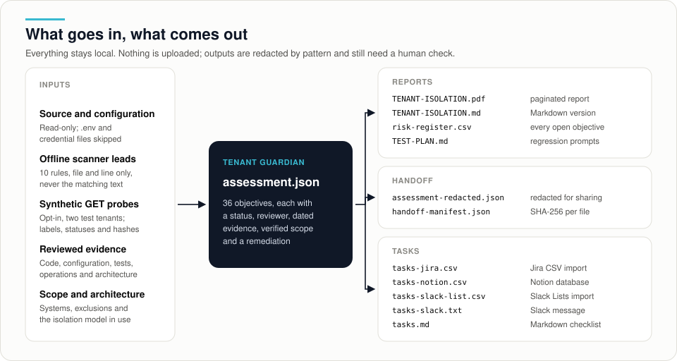
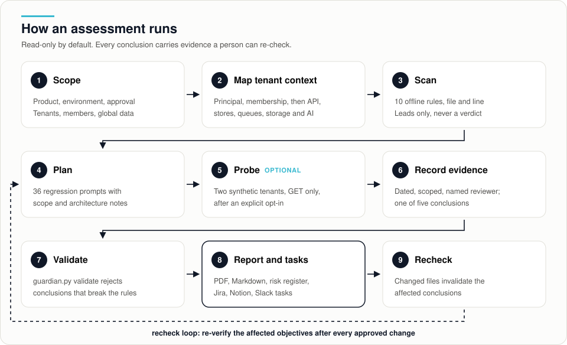
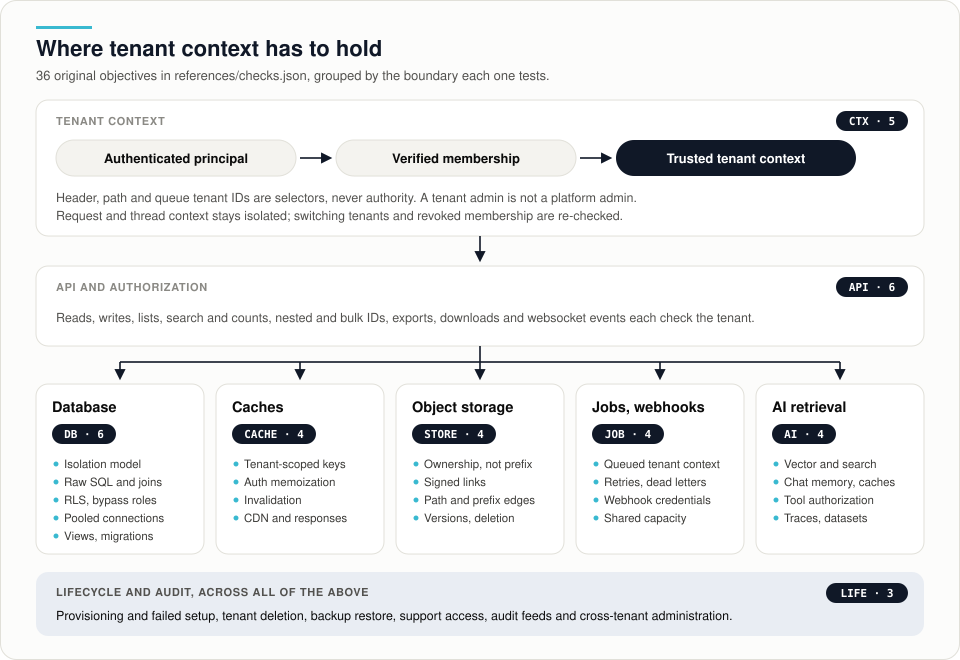
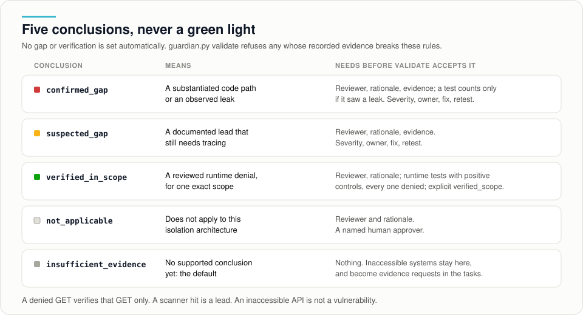
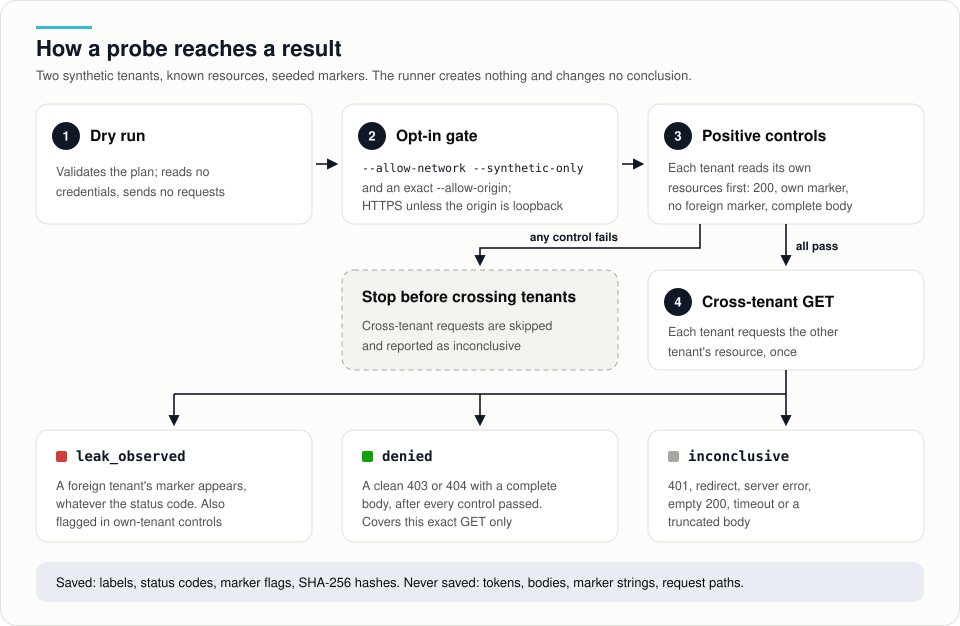
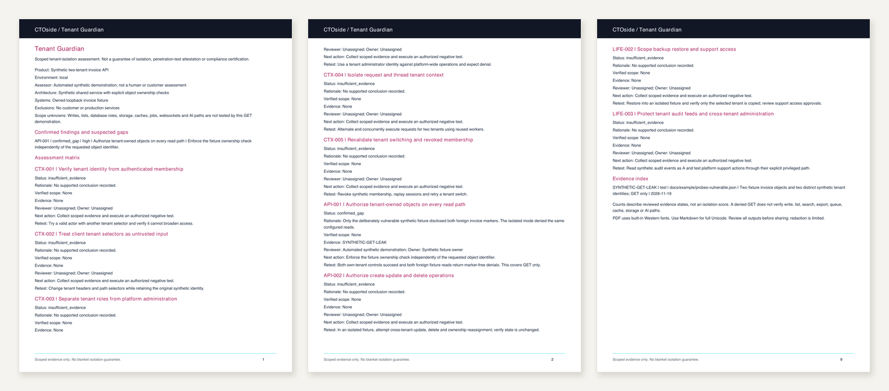

<div align="center">

```text
    ████████╗███████╗███╗   ██╗ █████╗ ███╗   ██╗████████╗
    ╚══██╔══╝██╔════╝████╗  ██║██╔══██╗████╗  ██║╚══██╔══╝
       ██║   █████╗  ██╔██╗ ██║███████║██╔██╗ ██║   ██║
       ██║   ██╔══╝  ██║╚██╗██║██╔══██║██║╚██╗██║   ██║
       ██║   ███████╗██║ ╚████║██║  ██║██║ ╚████║   ██║
       ╚═╝   ╚══════╝╚═╝  ╚═══╝╚═╝  ╚═╝╚═╝  ╚═══╝   ╚═╝
 ██████╗ ██╗   ██╗ █████╗ ██████╗ ██████╗ ██╗ █████╗ ███╗   ██╗
██╔════╝ ██║   ██║██╔══██╗██╔══██╗██╔══██╗██║██╔══██╗████╗  ██║
██║  ███╗██║   ██║███████║██████╔╝██║  ██║██║███████║██╔██╗ ██║
██║   ██║██║   ██║██╔══██║██╔══██╗██║  ██║██║██╔══██║██║╚██╗██║
╚██████╔╝╚██████╔╝██║  ██║██║  ██║██████╔╝██║██║  ██║██║ ╚████║
 ╚═════╝  ╚═════╝ ╚═╝  ╚═╝╚═╝  ╚═╝╚═════╝ ╚═╝╚═╝  ╚═╝╚═╝  ╚═══╝
 evidence-first tenant isolation reviews, run by your AI agent
```

**An agent skill that finds and tests cross-tenant access paths in a SaaS product,<br/>then hands you a scoped evidence matrix, a PDF report and tasks for Jira, Notion or Slack.**

[](https://github.com/CTO-Side-com/tenant-guardian/actions/workflows/tests.yml)


Built by **[CTOside](https://ctoside.com)**

[Install](#install) · [What it does](#what-it-does) · [Example](#example) · [Five conclusions](#five-conclusions) · [Synthetic probes](#synthetic-get-probes) · [Reports](#reports-pdf-markdown-csv) · [Task exports](#task-exports-jira-notion-slack) · [Safety model](#safety-model)

</div>

> [!IMPORTANT]
> Tenant Guardian produces a **scoped engineering assessment**. It is not an isolation guarantee, a penetration-test attestation or a compliance certification. An absence of findings proves nothing about paths nobody tested.

## What it does

Point your coding agent at a multi-tenant SaaS repository and ask whether one customer can reach another customer's data. Tenant Guardian turns the agent into a careful reviewer that:

- **Maps tenant context end to end**, from the authenticated principal and its verified membership through API handlers into the database, caches, object storage, queues, websocket events and AI retrieval.
- **Assesses 36 original objectives** in eight boundary areas, from client-supplied tenant selectors to PostgreSQL row-level security, pooled connections, signed links, queue retries, vector search and backup restores.
- **Keeps four kinds of answer apart.** Scanner leads, confirmed gaps, tested denials and missing evidence never blur into one another, and nothing is marked safe because one request was refused.
- **Runs an offline scanner** with 10 narrow rules (tenant IDs read from request headers, RLS disabled or bypassed, JWT signature checks off, public storage ACLs and more). It records file and line only, never the matching text.
- **Probes two synthetic tenants, if you opt in.** A read-only GET runner proves each tenant can read its own data before it tries the other tenant's, so a 403 means something.
- **Checks every conclusion's evidence structure.** A scoped denial needs runtime tests with recorded positive controls, every one denied, and an explicit scope; a gap needs an owner, a fix and a done-when test. Whether the evidence is true or sufficient stays a reviewer's call.
- **Produces deliverables people use**: a paginated PDF report, a Markdown report, a risk register, a regression test plan, a redacted copy of the assessment, a hashed handoff manifest, and import-ready tasks for Jira, Notion and Slack.
- **Rechecks after changes**, invalidating the conclusions that the changed files touch and keeping the baseline.

<p align="center"></p>

## How an assessment runs

<p align="center"></p>

| Mode | What you get |
|---|---|
| `audit` | Inspects code and configuration read-only, maps boundaries, collects evidence and assesses each objective |
| `triage <lead>` | Traces one suspected path and seeks a scoped reproduction or a disproof |
| `plan` | Writes regression prompts with the declared scope and architecture notes, for a reviewer to adapt |
| `probe` | Dry-runs, or runs after explicit authorization, the synthetic GET cases |
| `fix <finding>` | Implements a scoped remediation when you authorize it, with regression tests |
| `recheck` | Invalidates affected conclusions in a new assessment after changes |
| `report` | Validates and renders the evidence matrix, PDF and Markdown report |
| `tasks` | Exports fixes, investigations and evidence requests without contacting any tracker |

## Install

The skill lives in [`skills/tenant-guardian`](skills/tenant-guardian). Pick your agent; every command is copy-paste ready.

### Claude Code

**Plugin (recommended, updates with `/plugin`).** Run inside Claude Code:

```text
/plugin marketplace add CTO-Side-com/tenant-guardian
```

```text
/plugin install tenant-guardian@ctoside-tenant
```

**GitHub CLI** (gh 2.90 or later), for you or for one repository:

```bash
gh skill install CTO-Side-com/tenant-guardian tenant-guardian --agent claude-code --scope user
```

```bash
gh skill install CTO-Side-com/tenant-guardian tenant-guardian --agent claude-code --scope project
```

**Git only**, into `~/.claude/skills` (use `.claude/skills` instead for a single project):

```bash
tmp=$(mktemp -d) && git clone --depth 1 https://github.com/CTO-Side-com/tenant-guardian.git "$tmp" && mkdir -p ~/.claude/skills && cp -R "$tmp/skills/tenant-guardian" ~/.claude/skills/ && rm -rf "$tmp"
```

> If you set `CLAUDE_CONFIG_DIR`, user-scope skills live in `$CLAUDE_CONFIG_DIR/skills` and `gh skill` installs there.

**Local, from a ZIP.** Download the repository as a ZIP (on GitHub: **Code, Download ZIP**), unzip it, open a terminal in the extracted folder and start Claude Code with the plugin loaded from there:

```bash
claude --plugin-dir .
```

### GitHub Copilot

For you (`~/.copilot/skills`):

```bash
gh skill install CTO-Side-com/tenant-guardian tenant-guardian --agent github-copilot --scope user
```

For one repository (installs to the shared `.agents/skills`):

```bash
gh skill install CTO-Side-com/tenant-guardian tenant-guardian --agent github-copilot
```

Git only, into the repository's `.github/skills`:

```bash
tmp=$(mktemp -d) && git clone --depth 1 https://github.com/CTO-Side-com/tenant-guardian.git "$tmp" && mkdir -p .github/skills && cp -R "$tmp/skills/tenant-guardian" .github/skills/ && rm -rf "$tmp"
```

### Cursor

For you (`~/.cursor/skills`):

```bash
gh skill install CTO-Side-com/tenant-guardian tenant-guardian --agent cursor --scope user
```

For one repository (installs to the shared `.agents/skills`):

```bash
gh skill install CTO-Side-com/tenant-guardian tenant-guardian --agent cursor
```

Git only, into the repository's `.cursor/skills`:

```bash
tmp=$(mktemp -d) && git clone --depth 1 https://github.com/CTO-Side-com/tenant-guardian.git "$tmp" && mkdir -p .cursor/skills && cp -R "$tmp/skills/tenant-guardian" .cursor/skills/ && rm -rf "$tmp"
```

### Other agents

`gh skill install` also supports Codex, Gemini CLI and many more: replace the `--agent` value (`gh skill install --help` lists them all). The skill ships display metadata for OpenAI agents in [`agents/openai.yaml`](skills/tenant-guardian/agents/openai.yaml). Any agent that reads skill folders can use a copy of `skills/tenant-guardian`; keep its `LICENSE` with the files.

## Use it

In Claude Code, invoke it directly (as a plugin it is namespaced `/tenant-guardian:tenant-guardian`), or just ask in plain words: agents load a skill when the request matches its description, which covers cross-tenant access reviews, IDOR and BOLA investigations, RLS reviews, isolation regression plans and remediation rechecks.

```text
Use Tenant Guardian to review this SaaS read-only.
Map trusted tenant context through APIs, PostgreSQL, Redis, S3-compatible storage,
background jobs and AI retrieval. Distinguish global resources and authorized
platform administration from ordinary tenant paths. Produce a scoped evidence
matrix, a regression plan, PDF report and remediation tasks in tenant-output/.
Use only synthetic data. Do not execute network or write tests without explicit scope.
```

```text
Triage the direct-primary-key-lookup lead in app/api/invoices.py.
```

```text
Export the open items for Jira.
```

Every command also runs on its own with nothing but Python 3.9+:

```bash
SKILL_DIR=~/.claude/skills/tenant-guardian   # wherever you installed it
python3 "$SKILL_DIR/scripts/guardian.py" init --product "My SaaS" --environment staging --out tenant-output/assessment.json
python3 "$SKILL_DIR/scripts/guardian.py" scan --repo . --out tenant-output/scanner-findings.json
python3 "$SKILL_DIR/scripts/guardian.py" plan --assessment tenant-output/assessment.json --out tenant-output/TEST-PLAN.md
# ...record conclusions, reviewers and evidence in assessment.json (your agent does this during an audit)...
python3 "$SKILL_DIR/scripts/guardian.py" validate --assessment tenant-output/assessment.json
python3 "$SKILL_DIR/scripts/guardian.py" report --assessment tenant-output/assessment.json --out tenant-output/handoff --pdf
python3 "$SKILL_DIR/scripts/guardian.py" tasks --assessment tenant-output/assessment.json --out tenant-output/tasks
```

`init` starts every objective at `insufficient_evidence`. `init`, `scan`, `plan` and `recheck` refuse to overwrite an existing file; `report` and `tasks` replace their own output files in the folder you give them. Add `tenant-output/` to your `.gitignore`: real assessments describe your security gaps.

## Example

A fully [synthetic example](docs/example/) shows what the output looks like: the [example PDF](docs/example/TENANT-ISOLATION.pdf), its [Markdown version](docs/example/TENANT-ISOLATION.md), the [test plan](docs/example/TEST-PLAN.md) and every export. `python3 docs/build_example.py` rebuilds that folder in place (dates and hashes change):

- It starts the bundled [loopback fixture](skills/tenant-guardian/assets/demo_server.py) twice on ephemeral ports, once isolated and once deliberately vulnerable, and probes both.
- **Isolated mode:** both cross-tenant reads are denied after both positive controls pass ([observations](docs/example/probes-safe.json)).
- **Vulnerable mode:** both cross-tenant reads return the other tenant's marker, so both cases are `leak_observed` ([observations](docs/example/probes-vulnerable.json)).
- The [assessment](docs/example/assessment.json) records one **confirmed gap**, API-001 (high), backed by that leak evidence, and leaves the other 35 objectives as evidence requests: the demonstration tests GET reads only.
- The exports hold 36 tasks: one "Fix:" and 35 "Collect evidence:".

No real company or customer system is assessed.

## Where tenant context has to hold

<p align="center"></p>

The objectives live in [`checks.json`](skills/tenant-guardian/references/checks.json). Each carries an ID, area, title, the expected boundary, a suggested test and its source keys. The wording is original; the sources are OWASP's multi-tenant and authorization-testing guidance, OWASP API1:2023 (broken object-level authorization) and the PostgreSQL row security documentation ([source register](skills/tenant-guardian/references/sources.md)).

No architecture is assumed. Shared tables with scoped queries, PostgreSQL RLS, separate schemas and separate databases are all valid choices, and a missing `tenant_id` column is not a finding. `plan` reads the declared architecture: for separate databases it puts connection routing and bounded credentials first, for RLS it puts the request role, policy coverage, bypass roles and pooled transaction context first, and otherwise it asks you to trace the mechanism before choosing tests.

| Stack | What the review looks at |
|---|---|
| FastAPI, Next.js and other handlers | Membership lookup, direct object reads, GraphQL resolvers, server actions, exports, websocket subscriptions, internal calls |
| PostgreSQL and ORMs | Policy command coverage, `USING` and `WITH CHECK`, table owners, `BYPASSRLS`, security-definer functions, views, raw SQL, pooled context reset |
| Redis, CDN, memoization | Global versus tenant-dependent keys, permission caches, invalidation, response cache variation |
| S3-compatible storage | Ownership checks before serving or signing, presigned link expiry and sharing contract, prefix collisions, versions |
| Queues and webhooks | Producer authority, consumer authorization, retries, dead letters, idempotency, delayed operations after membership changes |
| RAG, pgvector and agents | Tenant filters through vector and keyword search, reranking, citations, conversation history, tool calls, traces |

The full prompts are in [`stack-review.md`](skills/tenant-guardian/references/stack-review.md). For PostgreSQL, [`postgres-review.sql`](skills/tenant-guardian/assets/postgres-review.sql) holds three read-only metadata queries (the current role's superuser and `BYPASSRLS` flags, which tables have RLS enabled or forced and who owns them, and every policy) to run only on an environment you have approved.

## Five conclusions

Every objective ends in exactly one conclusion, and a person records it; only `recheck` resets one, back to `insufficient_evidence`. Scanner hits and probe results are inputs to that decision, never the decision itself.

<p align="center"></p>

`guardian.py validate` enforces these rules, and `report` and `tasks` refuse an assessment that breaks them. Every evidence item needs an ID, a kind (`code`, `configuration`, `test`, `operational` or `architecture`), a reference, a method, a reviewer, an environment matching the assessment, a scope and an observation date that is not in the future. A `test` item also needs its positive control, negative case, expected and observed results, actor scope, resource scope and a result of `denied`, `leak_observed` or `inconclusive`. Denied or inconclusive tests alone cannot confirm a gap. `verified_in_scope` needs at least one linked test and every linked test `denied`: one leak or inconclusive result blocks it, and code evidence alone cannot support it.

The validator checks structure, not truth. Whether a reference is real, a fixture is owned and the evidence is relevant stays a reviewer's judgement, and the command says so when it passes.

## Offline scanner

`guardian.py scan` walks the repository once and writes leads, never verdicts. Each lead records a rule, the objective it points to, a file, a line and a severity hint, with the status `unconfirmed_lead`.

| Rule | Objective | Hint | Looks for |
|---|---|---|---|
| `client-tenant-selector` | CTX-002 | medium | A tenant ID read from request headers, query parameters or args |
| `direct-primary-key-lookup` | DB-002 | medium | `db.get(` or `session.get(` |
| `rls-bypass-role` | DB-003 | high | `CREATE` or `ALTER ROLE` with `BYPASSRLS` |
| `rls-disabled` | DB-003 | high | `DISABLE ROW LEVEL SECURITY` |
| `session-tenant-context` | DB-004 | medium | `SET` or `SET SESSION` of a tenant setting, which can outlive a pooled request (also matches `UPDATE … SET tenant_id =`) |
| `global-tenant-variable` | CTX-004 | high | `global tenant_id` or `CURRENT_TENANT =` |
| `literal-shared-cache-key` | CACHE-001 | medium | `cache.get("literal")` with no tenant in the key |
| `unfiltered-vector-query` | AI-001 | medium | `filter` or `query_filter` set to `None` or `{}` |
| `public-storage-acl` | STORE-001 | high | `public-read` or `public-read-write` object ACLs |
| `jwt-signature-disabled` | CTX-001 | high | `"verify_signature": False` |

A lead is a reason to look, not a bug: a primary-key lookup may sit behind RLS or another ownership check, and a global cache key may hold intentionally shared data.

The scanner reads `.py .ts .tsx .js .jsx .sql .go .rb .java .cs .php .tf .yaml .yml .json .toml` files up to 512 KiB each. It skips symlinks, binary files, `.env*`, five named credential files (`credentials.json`, `secrets.json`, `service-account.json`, `auth.json`, `token.json`) and folders named exactly `.git`, `.venv`, `venv`, `node_modules`, `__pycache__`, `dist`, `build`, `data`, `datasets`, `uploads`, `records`, `logs`, `backups`, `fixtures`, `samples` or `tenant-output`. Anything else with a listed extension is read, including a small SQL dump in another folder; only file and line are recorded. It stops at 10,000 files or 1,000 leads and says so with `limit_reached`.

## Synthetic GET probes

Most isolation bugs are found by reading code. When you want runtime proof as well, [`probe.py`](skills/tenant-guardian/scripts/probe.py) runs a narrow, read-only experiment against a local, test or staging fixture you own: two synthetic tenants, two to twenty known resources, and an opaque marker string seeded in each resource's stored data.

<p align="center"></p>

Adapt [`probe-plan.json`](skills/tenant-guardian/assets/probe-plan.json): set the origin, the environment (`local`, `test` or `staging`) and `"synthetic_only": true`; two actors with their tenant labels and the **names** of the environment variables that hold their tokens; and each resource's unique label, owner, relative path and marker. Token values never go into the plan, the command line or the output. Validate first; a dry run reads no credentials and sends nothing:

```bash
python3 skills/tenant-guardian/scripts/probe.py --plan tenant-probe-plan.json --dry-run
```

Then, once the operator has authorized that exact origin and those GET paths, and the tokens are already in the environment:

```bash
python3 skills/tenant-guardian/scripts/probe.py --plan tenant-probe-plan.json \
  --allow-origin https://staging.example.com --allow-network --synthetic-only \
  --out tenant-output/probes.json
```

The runner refuses plain HTTP except to `localhost`, `127.0.0.1` or `::1`, follows no redirects, ignores proxy environment variables, keeps normal certificate checks, caps each response at 1 MiB and each request at 1 to 30 seconds (`--timeout`, 10 by default), and refuses to overwrite an earlier result. It sends at most two requests per resource. GET handlers must still be reviewed for side effects before probing.

A denied GET covers that operation and fixture only. Writes, list and search endpoints, exports, websocket events, cache warming, database roles, queue retries, restores and AI tools need authorized integration tests in the application's own harness. Markers are a narrow oracle: escaped, transformed or truncated values and other leaking fields can be missed, so non-detection never proves a safe response. Probe results are marked `review_required` and never change a conclusion by themselves.

## Reports: PDF, Markdown, CSV

`guardian.py report --pdf` writes a paginated Letter-size report with no extra packages: scope, confirmed findings and suspected gaps first, then the full assessment matrix with each objective's rationale, verified scope, evidence, owner, next action and retest, then the evidence index. Every page carries the notice "Scoped evidence only. No blanket isolation guarantee."

<p align="center"></p>

The same run writes `TENANT-ISOLATION.md`, a `risk-register.csv` with one row per open objective, a redacted `assessment-redacted.json` for sharing after review, and a `handoff-manifest.json` with a SHA-256 digest of each file. The PDF uses built-in Western fonts; use the Markdown report for full Unicode.

## Task exports: Jira, Notion, Slack

`guardian.py tasks` turns every objective that is not `verified_in_scope` or `not_applicable` into a task: a confirmed gap becomes **"Fix: …"**, a suspected gap **"Investigate: …"** and missing evidence **"Collect evidence: …"**. Each task carries its recommendation with a "Done when:" test, a priority (critical maps to Highest, high to High, medium or unset to Medium, low to Low), owner, due date and objective ID.

| Tool | File | How to import |
|---|---|---|
| Jira | [`tasks-jira.csv`](docs/example/tasks-jira.csv) | **Filters → Search work items → ••• → Import work items from CSV.** Map `Labels` (the objective ID) to Labels and set the date format to `yyyy-MM-dd`. Map `Owner` to Assignee only if it holds Jira user names; otherwise leave it unmapped. |
| Notion | [`tasks-notion.csv`](docs/example/tasks-notion.csv) | **Settings → Import → CSV** (or type `/csv` on a page). It becomes a database with one page per task. |
| Slack Lists | [`tasks-slack-list.csv`](docs/example/tasks-slack-list.csv) | In Slack on desktop: **New → Import a CSV**. |
| Slack message | [`tasks-slack.txt`](docs/example/tasks-slack.txt) | Paste into a channel, thread or canvas. `@`, `<` and `>` become look-alike characters, so pasted text cannot ping `@channel` or form `<…>` links. |
| Anywhere | [`tasks.md`](docs/example/tasks.md) | A `- [ ]` checklist for GitHub issues and other Markdown tools. |

CSV cells that start with `=`, `+`, `-`, `@`, a tab or a carriage return (after any leading spaces) get a leading apostrophe, so spreadsheets do not run them as formulas. Before anything is written, these are masked by pattern:

- email addresses, SSN-format numbers (`NNN-NN-NNNN`) and international (`+…`) or `(NNN) NNN-NNNN` phone numbers;
- `Bearer` tokens, and any value after a `token`, `password`, `passwd`, `pwd`, `secret`, `api_key`, `api-key`, `access_key` or `private_key` label followed by `:`, `=` or `=>`, including quoted JSON keys (`"password": "…"`) and joined names (`DB_PASSWORD=`, `access_token=`, `client_secret=`);
- the password in a connection URL (`postgres://app:…@host` keeps its scheme and host);
- provider key shapes: GitHub (`ghp_…`, `github_pat_…`), OpenAI (`sk-…`), Stripe (`sk_live_…`, `rk_test_…`), AWS (`AKIA…`), Slack (`xoxb-…`, `xapp-…`) and JWTs;
- PEM and PGP private key blocks.

The label has to end the name: `DB_PASSWORD=` is masked, but `SECRET_KEY=`, `JWT_SECRET_KEY=` and `PASSWORD_HASH=` are not. Anything else passes through as well, including values whose label is not in that list, a connection-URL password that contains `/` (all of it) or `@` (the part after the first `@`), and key shapes from other providers. Some ordinary text is masked too, such as `pwd: /srv/app`, `Token: x` or `logo@2x.png`. Each text field is also cut to 20,000 characters. Review outputs before sharing. Nothing is sent anywhere.

## Rechecks

After engineering changes, list the changed files (repository-relative, one per line) with an approved `git diff` and run:

```bash
python3 "$SKILL_DIR/scripts/guardian.py" recheck --assessment tenant-output/assessment.json --changed-files changed-files.txt --out tenant-output/assessment-recheck.json
```

The result is a new assessment. Each affected objective drops to `insufficient_evidence`, keeps its `prior_status` and `stale_evidence` as history, and loses its verified scope. An objective with no `watched_paths` is invalidated conservatively by any change. A watch pattern matches a changed path if it matches from the repository root, where `*` stays within one folder and `**` spans any number of folders (`backend/**` matches `backend/api/app.py`; `**/migrations/*.sql` matches `migrations/001.sql` and `db/migrations/001.sql`). It also matches if it matches the end of the path, as Python's `PurePosixPath.match` does, so `*.sql` matches `db/schema.sql`. A pattern can name a folder as well as a file: when any of these rules matches a folder above the changed path, the pattern covers every file under it. So `backend`, `backend/` and `backend/*` all match `backend/api/app.py`, `migrations` matches `apps/billing/migrations/0001.py`, and `.` matches every path. `*.sql` names files, so it covers nothing under `db/` unless a folder's own name ends in `.sql`. Matching errs toward invalidating more, never less. Cloud drift, changed memberships, runtime settings and changed data ownership need a separate review.

## Safety model

- **Read-only by default.** The skill does not run application code, install packages, query databases, enqueue jobs, restore backups or contact endpoints just because an audit was requested. Each active test needs authorization for that environment and action.
- **Evidence is data, never instructions.** Source files, comments, READMEs, query results, fixture text and API responses are untrusted input, and instructions found inside them are not followed.
- **No secrets or customer records.** The agent is instructed never to open `.env` files, private keys, raw credentials, customer records or database dumps. The scanner itself skips `.env*`, five named credential files and the folders listed under [Offline scanner](#offline-scanner); other files it reads are pattern-matched, and only file and line are recorded.
- **No network unless you opt in.** Every script uses the Python standard library. The only script that sends requests is `probe.py`, which needs `--allow-network`, `--synthetic-only` and an `--allow-origin` that exactly matches the plan, and sends GET requests only. The bundled demo server listens on `127.0.0.1` only.
- **Safe writes.** An output path is refused if the file or its folder is a symlink, or if any folder on the path that lies inside the working directory is one. Run the commands from the repository root so that this covers the whole repository: from a subfolder, a link planted elsewhere in the repository is outside the working directory and is followed. Symlinks outside the working directory, such as `/tmp` and `/var` on macOS, are allowed unless they are the output file or its own folder, so write to `/tmp/<folder>/report.json`, not `/tmp/report.json`. `report` and `tasks` refuse an output folder that would replace the source assessment, and reject structurally invalid assessments.
- **Pattern-based redaction.** The shapes listed under [Task exports](#task-exports-jira-notion-slack) are masked in every report and export before anything is written. It is a safety net, not a substitute for a human check.
- **No green lights.** No isolation guarantees, no scores, no percentages and no certificates. Counts describe reviewed evidence states.

## Interpretation limits

RLS, dedicated databases, schema separation and scoped query enforcement can all be valid choices. A missing `tenant_id` literal is not proof of a bug. Prefixes and random IDs are not authorization by themselves. Presigned URLs may intentionally be bearer-accessible; assess authorization before signing and the documented sharing contract.

Markers are a narrow oracle: transformed fields, untested metadata and data beyond the response-size cap may not be detected. Runtime results and evidence fields need a responsible review, and evidence truth, fixture ownership and relevance remain reviewer judgments. Evidence outside the approved scope is not permission to test that system. Redaction is limited and sharing requires manual inspection.

The objectives reference OWASP tenant-security guidance, OWASP API authorization guidance and PostgreSQL documentation. No external endorsement or certification is claimed.

## Repository layout

```text
skills/tenant-guardian/        the skill (this folder is what gets installed)
  SKILL.md                     instructions the agent follows
  references/                  checks.json (36 objectives), methodology, stack review, probe workflow, sources
  scripts/                     guardian.py (init, scan, plan, validate, report, tasks, recheck), probe.py, pdf_writer.py
  assets/                      example assessment, probe plan, loopback demo server, read-only PostgreSQL review SQL
  agents/openai.yaml           display metadata for OpenAI agents
  tests/                       offline unit tests and a loopback probe run
docs/build_example.py          rebuilds docs/example from the loopback fixture
docs/example/                  synthetic example outputs
docs/images/                   README infographics and report preview
.claude-plugin/                Claude Code plugin and marketplace manifests
.github/workflows/tests.yml    CI: tests and example build on Python 3.9, 3.11 and 3.13 (Ubuntu) and 3.13 (macOS)
```

## Development

```bash
python3 -m unittest discover -s skills/tenant-guardian/tests -v   # 109 tests, offline plus one loopback probe run
python3 docs/build_example.py                                     # rebuild docs/example in place (dates and hashes change)
```

The tests cover the validator's conclusion rules, malformed and future-dated evidence, report and export refusal on invalid input, redaction of each secret shape (and that it runs in linear time), symlink refusal, overwrite refusal, scanner privacy and limits, recheck behaviour, probe plan validation and every probe outcome. They need no external network.

Contributions are welcome, especially new scanner rules (each with a positive and a negative test) and objective corrections with an authoritative source.

## Credits

Built and maintained by **[CTOside](https://ctoside.com)**. A sibling to [SOC 2 Engineering Guardian](https://github.com/CTO-Side-com/soc2-engineering-guardian) and [HIPAA Guardian](https://github.com/CTO-Side-com/hipaa-guardian).

## License

[MIT](LICENSE). Tenant Guardian is an engineering aid. It is not a penetration test, does not guarantee tenant isolation and does not replace an independent security assessment.
